<p align="center">
  <picture>
    <source media="(prefers-color-scheme: dark)" srcset="docs/readme/hero-dark.png">
    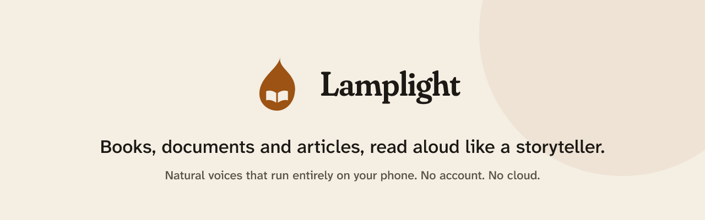
  </picture>
</p>

<p align="center">
  <a href="https://github.com/Himkush1414/keystone-works/actions/workflows/ci.yml"></a>
  <a href="https://github.com/Himkush1414/keystone-works/actions/workflows/android.yml"></a>
  
  
  
  <br>
  
  
  
  
  
</p>

---

## What it is

Lamplight is an Android app that reads your books, documents and articles aloud with natural voices. The voices run **entirely on the phone**. There's no account, no cloud and no tracking, and your library never leaves the device.

## Why it's different

- **A storyteller, not a screen reader.** Lamplight works out who is speaking, gives each character a voice that suits them, and performs the lines: a whisper is soft, a shout is loud, and the pause between two speakers feels like a turn in conversation.
- **Private by design.** Speech is generated on the device by an ONNX voice model. Nothing is uploaded.
- **Reads what you actually have.** It handles EPUB, PDF, Word, web pages and plain text, and _Clean Read_ quietly skips page numbers, running headers and citations.
- **Made for English and Hindi first.** It also speaks 29 more languages, with each language's support level stated honestly in Settings.

## Features

| Area                   | What you get                                                                                                                                                                                                                                           |
| ---------------------- | ------------------------------------------------------------------------------------------------------------------------------------------------------------------------------------------------------------------------------------------------------ |
| **Listen**             | Read-along with the current word underlined · speeds 0.75×–2× · sleep timer (minutes or end of chapter) · chapter contents · background playback with lock-screen controls · resume where you left off                                                 |
| **Cast**               | Speakers found in English, Hindi and Hinglish (speech verbs, names, pronouns, turn-taking) · voices cast by gender, age and temperament · voices kept for the whole book · your own choice for any character wins · merge two names into one character |
| **Expressive reading** | Whisper, shout, anger, excitement, sadness, fear, tenderness and calm shape pace and loudness · deliberate pauses for ellipses, dashes, speaker changes, reveals and scene breaks · optional natural breaths                                           |
| **Clean Read**         | Skips page numbers, running headers and footers, citations and links · review what was skipped and change it per document                                                                                                                              |
| **Pronunciation**      | Your own dictionary for names and terms · numbers, dates, times, money and units read as words, including Hindi (लाख, करोड़, साढ़े तीन बजे) · Hinglish read by the Hindi voice                                                                         |
| **Library**            | Import a file, paste text or start from a sample · shelves for books, documents and articles · "continue listening" · search across titles and full text                                                                                               |
| **Voices**             | 10 voices · Live, Studio and Studio+ quality, or Automatic · voice and quality per document                                                                                                                                                            |
| **Comfort**            | Light and dark themes · four reader themes · Literata, Atkinson Hyperlegible and OpenDyslexic · reduce motion · interface in English, Spanish, German, French and Brazilian Portuguese                                                                 |

## Screenshots

<table>
  <tr>
    <td align="center">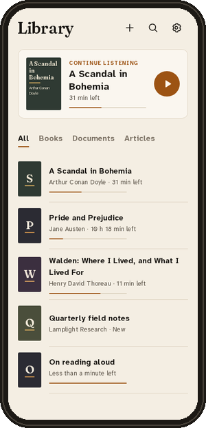<br><sub><b>Library</b></sub></td>
    <td align="center">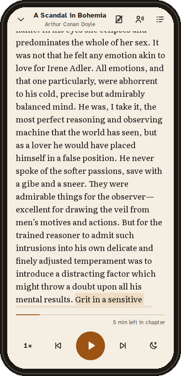<br><sub><b>Read-along player</b></sub></td>
    <td align="center">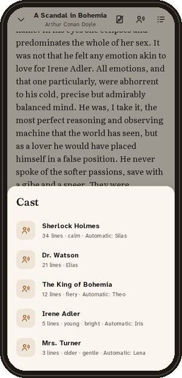<br><sub><b>Cast</b></sub></td>
    <td align="center">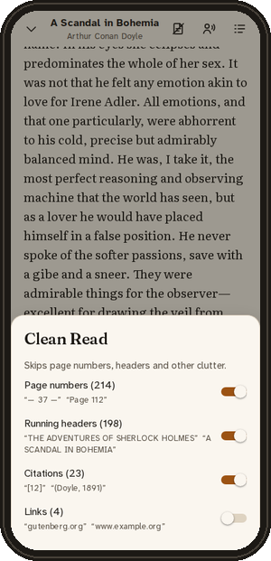<br><sub><b>Clean Read</b></sub></td>
  </tr>
  <tr>
    <td align="center">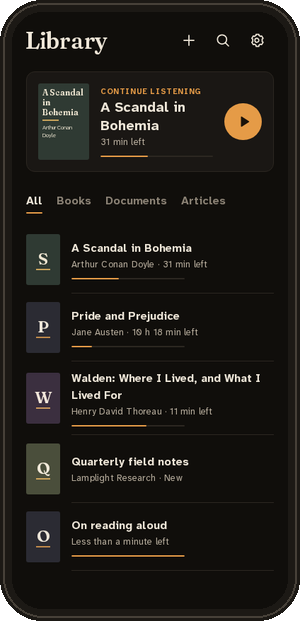<br><sub>Library · dark</sub></td>
    <td align="center">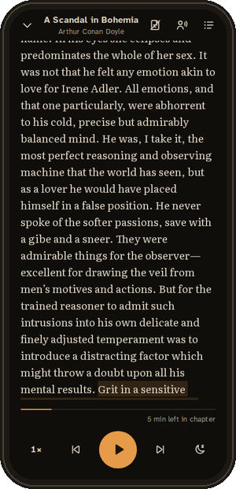<br><sub>Player · dark</sub></td>
    <td align="center">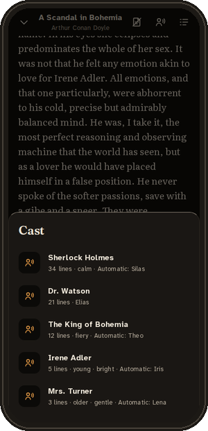<br><sub>Cast · dark</sub></td>
    <td align="center">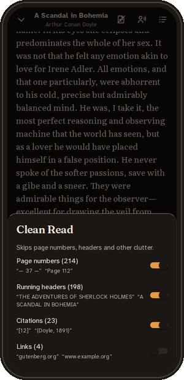<br><sub>Clean Read · dark</sub></td>
  </tr>
  <tr>
    <td align="center">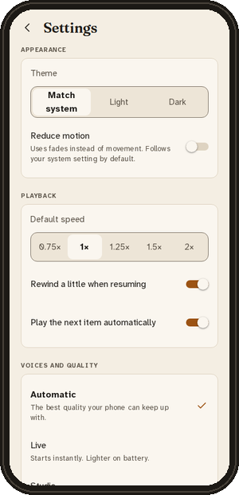<br><sub><b>Settings</b></sub></td>
    <td align="center"><br><sub><b>Search</b></sub></td>
    <td align="center">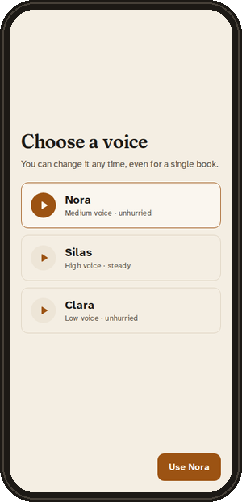<br><sub><b>Onboarding: choose a voice</b></sub></td>
    <td align="center">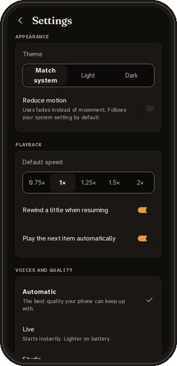<br><sub>Settings · dark</sub></td>
  </tr>
</table>

## How it works

1. **Import.** `@lamplight/core` turns EPUB, PDF, DOCX, HTML or text into blocks, chapters and sentences, detects the language, and marks clutter for Clean Read.
2. **Understand.** Cast finds the dialogue, works out who says each line, and profiles every character. It all happens once, at import, and is stored in SQLite.
3. **Perform.** At play time, the queue builder normalises each sentence for speech (numbers, abbreviations, Hinglish), picks its voice, and plans its delivery: pace, loudness, the pause after it, and a breath before it.
4. **Speak.** The Kotlin engine runs the voice model with ONNX Runtime ahead of the playhead, applies the performance, caches the audio, and plays it through a Media3 session.

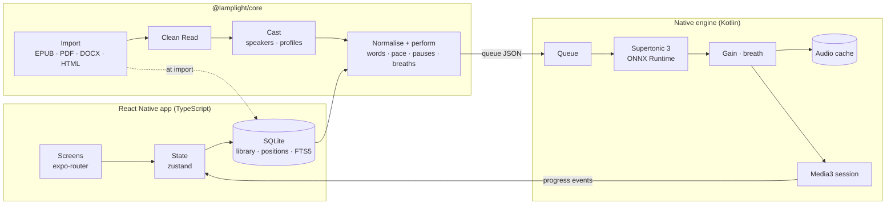

## Built with

| Layer            | Technology                                                                                                                         |
| ---------------- | ---------------------------------------------------------------------------------------------------------------------------------- |
| Mobile app       | Expo SDK 58 · React Native 0.88 · React 19 · expo-router · TypeScript 6 · zustand 5 · Reanimated 4                                 |
| Storage          | expo-sqlite with FTS5 full-text search; everything stays on the device                                                             |
| Shared core      | `@lamplight/core` (TypeScript): import (htmlparser2, fflate), Clean Read, Cast, text normalisation, performance plan               |
| Native engine    | Kotlin Expo module · ONNX Runtime for Android 1.31 · AndroidX Media3 1.11 (session and playback)                                   |
| Voice model      | Supertonic 3 by Supertone (int8, 31 languages, 10 voices), bundled in the app                                                      |
| Reference engine | `@lamplight/engine-web`: a TypeScript port on onnxruntime-node, used to check the Kotlin engine against the same output            |
| Design system    | `@lamplight/tokens` and `@lamplight/icons` · Literata, Fraunces, Atkinson Hyperlegible Next, OpenDyslexic                          |
| Backend          | None, by design. The app works fully offline and needs no account                                                                  |
| Quality          | Vitest · ESLint · Prettier · a secret scan on every tracked file · JUnit 5 tests that run the Kotlin engine against the real model |
| CI               | GitHub Actions: typecheck, lint, format and tests · Kotlin engine on the JVM with the real model · Android arm64 build             |

## Project structure

```text
apps/
  mobile/                  Expo app: screens (src/app), library, player, settings, onboarding
    modules/lamplight-engine/
      android/             Kotlin engine: ONNX synthesis, playback, cache, performance
      engine-core-jvm/     Runs the same engine sources on the JVM for tests
packages/
  core/                    Import, Clean Read, Cast, normalisation, queue and performance plan
  engine-web/              TypeScript reference engine (parity tests)
  tokens/                  Colours, type, spacing and motion
  icons/                   Icon set
tooling/scripts/           verify, secret scan, engine assets, brand and font tooling
docs/                      Handoff notes and README assets
```

## Getting started (developers)

Prerequisites: Node 24 or later, JDK 17, and the Android SDK (for device builds).

```bash
npm ci
npm run verify              # secret scan, typecheck, lint, format and every test
cd apps/mobile && npx expo start
```

Android build:

```bash
cd apps/mobile
npx expo prebuild --platform android
cd android && ./gradlew -PreactNativeArchitectures=arm64-v8a :app:assembleDebug
```

The build downloads the voice-model asset pack and refuses it unless its SHA-256 checksum matches. The engine's JVM tests run with `gradle test` in `apps/mobile/modules/lamplight-engine/engine-core-jvm`.

## Roadmap

**Shipped**

- [x] Import of EPUB, PDF, DOCX, HTML, text and paste · library, shelves and full-text search
- [x] On-device voices with read-along, sleep timer, contents, background playback and resume
- [x] Clean Read with a per-document review · pronunciation dictionary
- [x] Cast: speakers in English, Hindi and Hinglish; voices cast by age and temperament and kept for the whole book
- [x] Expressive reading: emotion, deliberate pauses and natural breaths
- [x] Hindi numbers, dates and times · Hinglish read by the Hindi voice · language quality tiers

**Planned**

- [ ] Seamless, gap-free reading, with sentences prepared further ahead
- [ ] Natural switching between Hindi and English within a sentence
- [ ] "What does this word mean here?" while listening
- [ ] Backup and restore · import from the share sheet and from web links
- [ ] Bookmarks and highlights · audio export
- [ ] Website and store release

## Credits

| Work                                                                                                                                                                                                                              | Author                                                             | License                | How it's used                                                 |
| --------------------------------------------------------------------------------------------------------------------------------------------------------------------------------------------------------------------------------- | ------------------------------------------------------------------ | ---------------------- | ------------------------------------------------------------- |
| [Supertonic 3](https://huggingface.co/Supertone/supertonic-3) voice model                                                                                                                                                         | Supertone Inc.                                                     | BigScience Open RAIL-M | Bundled; speaks every sentence                                |
| [supertonic](https://github.com/supertone-inc/supertonic) reference implementation                                                                                                                                                | Supertone Inc.                                                     | MIT                    | Text preprocessing follows it                                 |
| [WordNet 3.1](https://wordnet.princeton.edu)                                                                                                                                                                                      | Princeton University                                               | WordNet License        | English meanings for "What does this word mean here?"         |
| [Wiktionary](https://en.wiktionary.org) Hindi entries via [kaikki.org](https://kaikki.org)                                                                                                                                        | Wiktionary contributors                                            | CC BY-SA 4.0           | Hindi meanings and Hindi words for English ones               |
| [ONNX Runtime](https://github.com/microsoft/onnxruntime)                                                                                                                                                                          | Microsoft                                                          | MIT                    | Runs the model on Android and in tests                        |
| [AndroidX Media3](https://github.com/androidx/media)                                                                                                                                                                              | Google                                                             | Apache-2.0             | Playback and media session                                    |
| [Expo](https://github.com/expo/expo) · [React Native](https://github.com/facebook/react-native)                                                                                                                                   | Expo · Meta                                                        | MIT                    | App framework                                                 |
| [htmlparser2](https://github.com/fb55/htmlparser2) · [fflate](https://github.com/101arrowz/fflate)                                                                                                                                | Felix Böhm · Arjun Barrett                                         | MIT                    | HTML and archive parsing                                      |
| [Literata](https://github.com/googlefonts/literata) · [Fraunces](https://github.com/undercasetype/Fraunces) · [Atkinson Hyperlegible Next](https://www.brailleinstitute.org/freefont/) · [OpenDyslexic](https://opendyslexic.org) | TypeTogether · Undercase Type · Braille Institute · Abbie Gonzalez | SIL OFL 1.1            | Reader and interface fonts                                    |
| [ponytail](https://github.com/DietrichGebert/ponytail) · [gstack](https://github.com/garrytan/gstack)                                                                                                                             | Dietrich Gebert · Garry Tan                                        | MIT                    | Reference for engineering and review practices (no code used) |
| [OmniVoice](https://github.com/k2-fsa/OmniVoice)                                                                                                                                                                                  | k2-fsa                                                             | Apache-2.0             | Researched for multilingual voice (not shipped)               |

Sample texts are public-domain works by Jane Austen, Arthur Conan Doyle and Henry David Thoreau. Each font's license ships next to it in `apps/mobile/assets/fonts/`.

## License

Copyright © 2026 Lamplight. **All rights reserved.**

Lamplight is a commercial app. The source is public so you can read it, but no license is granted to copy, modify, distribute or publish it, or the app built from it. Third-party components remain under their own licenses, listed above.
